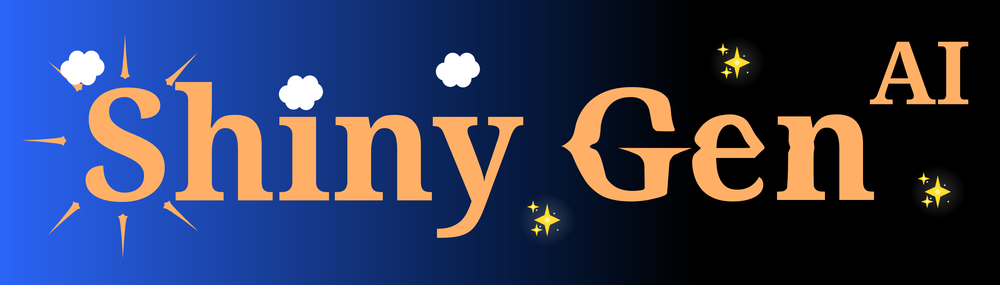

<div align="center">



### Retro games with AI

Describe a game and the AI builds it, plays it and fixes it. Game Boy Color, GBA, N64, GameCube, DS or Godot, in your browser or on your phone.

[**Play now**](https://shinygen.ai/play) · [What is Shiny Gen](https://shinygen.ai/what-is-shiny-gen) · [FAQ](https://shinygen.ai/faq) · [Pricing](https://shinygen.ai/pricing) · [Compare](https://shinygen.ai/compare) · [MCP](https://shinygen.ai/docs/mcp) · [npm](https://www.npmjs.com/package/shinygen)

Available on the [App Store](https://apps.apple.com/app/id6738890511) and [Google Play](https://play.google.com/store/apps/details?id=com.shinygen.ai)

</div>

---

**Shiny Gen (also written ShinyGen) is an AI game maker: describe a game, play it, and edit its assets,
code, and world with built-in AI tools, in your browser or on your phone.** Games are real projects you
own, on a real engine: the Godot engine in GDScript, or one of five retro engines we built (GBA, GBC,
N64, GameCube, and DS) whose games compile to a real file you can download (a ROM, a GameCube .dol, or a
DS .nds). Shiny Gen is free to make, play, and share; AI generation uses gems, and exporting games as files requires a purchase. It also ships an MCP server so AI assistants like Claude and ChatGPT
can build alongside you, and a `shinygen` npm package for embedding games on the web. It is available
on the App Store and Google Play.

Shiny Gen is unrelated to Shiny, the R and Python web-application framework maintained by Posit, and
unrelated to the Pokémon "shiny" mechanic or shiny hunting across game generations.

## Why make games with Shiny Gen

1. **Real cartridge games, not a look-alike.** Game Boy Color, Game Boy Advance and N64 games compile to
   real ROMs, and we have played them on real consoles through flash carts. Exporting ROM files requires
   a purchase.
2. **Six engines, one prompt.** Pick Game Boy Color, GBA, N64, GameCube or DS, engines we built
   ourselves, or the Godot engine in real GDScript, and describe your game the same way on all six.
3. **The AI plays its own game.** It runs what it made, takes screenshots, presses the controls, reads
   the errors and fixes them.
4. **Every device, nothing to install.** Make and play in any modern browser on Windows, Mac, Linux or a
   Chromebook, or in the iPhone, iPad and Android apps. Steam is coming soon.
5. **Describe, play, share, remix.** Every game gets a link anyone can open in a browser, every game in
   the feed can be remixed into your own copy, and multiplayer joins by a link.
6. **Free to make, play and share.** AI generation uses gems: new accounts get 30 free gems, and once
   your gems run out you get one free AI agent prompt each day. A starter pack is $2.99 for 150 gems.
   Exporting your games as files requires a purchase, and what you make is yours to sell with no
   revenue share.
7. **Bring your own AI.** Connect Claude, ChatGPT or any MCP client to `https://mcp.shinygen.ai/mcp`
   and it builds, plays and fixes your live game. Code your own assistant writes costs no gems. Shiny
   Gen's built-in agent does the same work in the app. See [Connect Claude or ChatGPT](docs/mcp.md).
8. **Dozens of original games to play.** Shiny Monsters, Shiny Kart, Shiny Farm Color, Dragon Hatchery
   64 and more, every one playable right away and ready to remix.

**Comparing AI game makers?** See how Shiny Gen stacks up against
[Rosebud](https://shinygen.ai/shiny-gen-vs-rosebud) and
[GDevelop](https://shinygen.ai/shiny-gen-vs-gdevelop), and when each one is the better pick:
[Compare AI game makers](https://shinygen.ai/compare).

This repository is the **public documentation and examples** for Shiny Gen. The canonical,
always-current version of every page lives at [shinygen.ai](https://shinygen.ai), and each doc here
links to its source. Shiny Gen is made by Shiny AI Technologies, LLC (Massachusetts, USA).

## Key pages

| Page | What it covers |
|---|---|
| [shinygen.ai](https://shinygen.ai/) | Home page; [shinygen.ai/play](https://shinygen.ai/play) opens the app in the browser |
| [What is Shiny Gen](https://shinygen.ai/what-is-shiny-gen) | Full description, how it works, specifications |
| [FAQ](https://shinygen.ai/faq) | Pricing and free gems, the engines, platforms, ownership, export, MCP |
| [Pricing](https://shinygen.ai/pricing) | What is free, gem packs, optional memberships, what a purchase unlocks |
| [Connect Claude or ChatGPT (MCP)](https://shinygen.ai/docs/mcp) | The hosted MCP server at `https://mcp.shinygen.ai/mcp` |
| [AI GBA game maker](https://shinygen.ai/gba-ai) | Make Game Boy Advance games with AI and export the .gba ROM |
| [AI Game Boy Color game maker](https://shinygen.ai/gbc-ai) | Make Game Boy Color games with AI and export the .gbc ROM |
| [Godot AI](https://shinygen.ai/godot-ai) | Make Godot games with AI in the browser and on phones |
| [Export your game as a ROM](https://shinygen.ai/export-rom) | The file each engine makes, how to export it, emulators and flash carts |
| [AI game makers compared](https://shinygen.ai/compare) | Shiny Gen next to other AI game makers |
| [Shiny Gen vs Rosebud](https://shinygen.ai/shiny-gen-vs-rosebud) | A head-to-head, including when Rosebud is the better pick |
| [Shiny Gen vs GDevelop](https://shinygen.ai/shiny-gen-vs-gdevelop) | A head-to-head, including when GDevelop is the better pick |
| [App Store](https://apps.apple.com/app/id6738890511) · [Google Play](https://play.google.com/store/apps/details?id=com.shinygen.ai) | The iPhone, iPad, and Android apps |

## How it compares

Shiny Gen's own pages compare it head to head with two other AI game makers. In short:

- **Rosebud** is a browser-based AI game maker for quick 2D, 3D, and voxel games shared by link. It is
  the better pick for a quick browser prototype, for remixing in its community, or for a Windows build
  for Steam on a Pro plan. Shiny Gen is the better fit for the same editor and agent on the browser,
  iPhone, iPad, and Android, real GDScript on the Godot engine, or a real retro-console file. Full
  comparison: [Shiny Gen vs Rosebud](https://shinygen.ai/shiny-gen-vs-rosebud).
- **GDevelop** is a free, open-source, no-code game engine with an event system and native exports, with
  AI helpers added to a conventional editor. It is the better pick for full control through events and
  native publishing to desktop and mobile stores. Shiny Gen is the better fit for starting from a
  description and having an AI agent build and test the game, or for making a real retro-console game.
  Full comparison: [Shiny Gen vs GDevelop](https://shinygen.ai/shiny-gen-vs-gdevelop).

Both are free to start. Shiny Gen does not yet make a native desktop or mobile build of your game. More
in [docs/compare.md](docs/compare.md) and at [shinygen.ai/compare](https://shinygen.ai/compare).

## Map of this repository

| Path | What is in it |
|---|---|
| [docs/](docs/README.md) | Guides: what Shiny Gen is, getting started, FAQ, pricing, embed, comparison, support |
| [docs/language/](docs/language/README.md) | Reference for the game languages: GDScript (Godot Engine) and sgba for the GBA, GBC and N64 (SG64) engines, with engine functions and budgets |
| [docs/mcp/](docs/mcp/README.md) | Connect Claude or ChatGPT through MCP: setup, tools, example prompts and an example tool sequence |
| [docs/gdscript-api-reference.md](docs/gdscript-api-reference.md) | The exact supported API surface for GDScript game code |
| [examples/](examples/README.md) | Four small open-licensed example games (MIT) you can paste into a new game |
| previews/ | Screenshots used by the docs |

## Start in 60 seconds

**Making a game?** Go to [shinygen.ai/play](https://shinygen.ai/play) or open the app, create a free
account, pick an engine, and describe what you want. The AI builds the game and you play it as it is
built. New accounts get 30 free gems for AI generation.

**Embedding a game on your own site?** One script tag boots the engine on your canvas:

```html
<!doctype html>
<canvas id="canvas"></canvas>

<script src="https://cdn.jsdelivr.net/npm/shinygen@4.6.5/shinygen.js"></script>
<script type="text/gdscript" name="Main">
extends Node3D

var cube: MeshInstance3D

func _ready():
    var camera = Camera3D.new()
    camera.transform.origin = Vector3(0.0, 2.0, 4.5)
    camera.look_at(Vector3(0.0, 0.8, 0.0))
    add_child(camera)

    var light = DirectionalLight3D.new()
    light.light_energy = 1.5
    light.rotation_degrees = Vector3(-40.0, -30.0, 0.0)
    add_child(light)

    cube = MeshInstance3D.new()
    var box = BoxMesh.new()
    box.size = Vector3(2.0, 2.0, 2.0)
    cube.mesh = box
    cube.transform.origin = Vector3(0.0, 1.0, 0.0)

    var mat = StandardMaterial3D.new()
    mat.albedo_color = Color(0.9, 0.15, 0.1)
    mat.metallic = 0.25
    mat.roughness = 0.35
    cube.set_surface_override_material(0, mat)
    add_child(cube)

func _process(delta):
    cube.rotation.y += delta * 1.2
    cube.rotation.x += delta * 0.5
</script>
<script>
  ShinyGen.start({ canvas: "#canvas" });
</script>
```

That's a red cube spinning under a directional light: a complete, running Shiny Gen scene.
See [Embed games on your website](docs/embed.md).

## How it works

1. **Pick an engine.** Godot, or one of the five retro engines: GBA, GBC, N64, GameCube, or DS.
2. **Describe a game.** Type what you want in plain language: a genre, a scene, a mechanic, or a whole idea.
   In the iPhone, iPad, and Android apps you can also attach a photo from your library or camera as a reference.
3. **The AI writes real game code.** For a Godot game, Shiny Gen generates GDScript (the Godot engine's scripting language) and runs it immediately; a retro game compiles to a real file for its engine.
4. **The AI tests what it built.** The agent runs the game, takes screenshots, presses the controls, and reads the game's errors, then fixes what is broken.
5. **Play it instantly.** The game runs as it is built. There is nothing to install and no engine to learn.
6. **Edit anything with the built-in editors.** Four AI creation surfaces: a game-code editor (GDScript), a 3D model editor, an image editor, and audio generation for sound effects and music.
7. **Share it.** Every game can be shared with a link, exported for the web as a zip you can host anywhere, or embedded on any website with the `shinygen` npm package. A retro game downloads as the ROM, .dol, or .nds you own. Exporting files requires a purchase.

Full walkthrough: [Getting started](docs/getting-started.md).

## What makes it different

**Six engines, one prompt.** Make a Godot game, or a real GBA, GBC, N64, GameCube, or DS game and
download the file you own. The retro engines compile new games you make in Shiny Gen; they are not
emulators and cannot play commercial or third-party ROMs. GBA, GBC, and N64 games have been played on
real hardware through a flash cart.

**The AI plays the game it makes.** It runs the game, takes screenshots, presses the controls, and
reads the errors, then fixes what is broken. The built-in agent and a connected Claude or ChatGPT use
the same tools.

**Trade and battle across consoles.** Multiplayer games are joined with a link or a room code, and the
Shiny Monsters games on Game Boy Color, Game Boy Advance, and DS trade and battle with each other over
the internet.

**It's browser-native *and* a real game engine.** Most AI game tools are one or the other.
Prompt-to-game websites are instant but keep your game inside their own runtime. Engine-based AI tools
produce a real project but run as desktop software. Shiny Gen is both at once: it runs entirely in the
browser, and what it builds is a game you own, written in real GDScript on the Godot engine.

**It's a whole game engine, not just a renderer.** With a web 3D library you get a renderer, and
everything else is hand-written: physics, input, scenes, cameras, tooling. Shiny Gen puts the Godot
engine itself in the browser (physics, scenes, input, audio, and editors included), running on a WebGPU
renderer compiled to WebAssembly.

**Its MCP server is hosted, not a desktop bridge.** Press Host External Agent in the app, connect Claude,
ChatGPT, or any MCP client, and the assistant can read your project, write code, generate assets, and run the game, live, in your browser.
Or give your AI an agent session link: it opens Shiny Gen in its own browser and works there, with nothing
open on your side ([how](docs/mcp.md#let-your-ai-run-shiny-gen-itself-nothing-open-on-your-side)).
Other game-engine MCP integrations bridge to a desktop editor on your machine; Shiny Gen's is hosted,
with nothing to install.

**Games live on the web.** A Shiny Gen game is a link anyone can open. Its owner can also export it for the web
as a zip to upload to itch.io or any web host (requires a purchase). An exported game makes no
calls to Shiny Gen, its engine version is pinned so our updates cannot break it, and once loaded it also
plays offline.

## Examples

Click any example to play it, then remix it with AI.

|  |  |  |
|:--:|:--:|:--:|
| [<br>**Shiny Sword Adventure**](https://shinygen.ai/gen/Shiny_Sword_Adventure) | [<br>**Shiny Aquarium**](https://shinygen.ai/gen/Shiny_Dive) | [<br>**Shiny Tribes**](https://shinygen.ai/gen/Shiny_Tribes) |
| [<br>**Shiny Platformer**](https://shinygen.ai/gen/Shiny_Platformer) | [<br>**Shiny Monster Catcher**](https://shinygen.ai/gen/Shiny_Monster_Catcher) | [<br>**Shiny Fighter**](https://shinygen.ai/gen/Shiny_Fighter) |
| [<br>**Reef**](https://shinygen.ai/gen/fable-reef) | [<br>**Black Hole**](https://shinygen.ai/gen/black-hole) | [<br>**Murmuration**](https://shinygen.ai/gen/boids-murmuration) |

**[All 99 examples](docs/examples.md)** · [Every game in the free catalog, by engine](https://shinygen.ai/docs/games)

## Embed games on your website

A Shiny Gen game runs natively on any web page: your portfolio, blog, or game site. It is **not an
iframe**: the engine boots on your canvas. By default it picks the engine per device: a desktop gets
WebGPU when it supports it, and phones, tablets and browsers without WebGPU get WebGL.

The easy way: in the Shiny Gen web app, open the **Share** menu on a game you own and choose **Export for
the web**. You get a zip with the page, your game, and a README, pinned to an exact engine version, ready
to upload to itch.io or any web host. Exporting requires a purchase. For
full control, use the script tag above, or `npm install shinygen`.

See [Embed games on your website](docs/embed.md).

## Connect Claude or ChatGPT

Shiny Gen ships a hosted MCP server at `https://mcp.shinygen.ai/mcp`. Connect an AI assistant and it can
build, edit, and play-test your project, live in your browser. There is nothing to install.

First start hosting in Shiny Gen, once per session: open your game at [shinygen.ai](https://shinygen.ai),
open the **Agent** tab, tap the model name to open the AI model picker, choose **Connect external model
with MCP**, and press **Host External Agent**. The app shows "Waiting for your AI to connect". Your
assistant cannot connect this way until you do this, and it works while that app stays open. (To let
your AI work with your app closed, give it an agent session link instead: see [docs/mcp.md](docs/mcp.md).)
Then connect from your client:

```
claude mcp add --transport http shinygen https://mcp.shinygen.ai/mcp
```

For Claude web/desktop, ChatGPT, or any other MCP client, add that same URL wherever your client
configures connectors. Authorization uses OAuth with three scoped permissions:

| Scope | What it allows |
|---|---|
| `projects.read` | See your project: what is on screen, the focused document, and its current state. |
| `projects.write` | Write and edit game code and asset documents. Code edits are free. |
| `assets.generate` | Run AI generation (images, 3D models, audio). Spends gems, with a daily gem cap. |

A connected assistant runs on your own AI plan, so its code edits cost no gems; only the generation it
runs spends gems. Accounts that have never made a purchase get a one-time free allowance of assistant
actions that change something (currently 100). It does not reset. Reading is never limited, and any
purchase, from the $2.99 starter pack, removes the allowance for good.

**Prefer not to wire up a connector?** Shiny Gen has its own AI agent built into the app, with the same
abilities: reading your project, writing game code, generating assets, and play-testing what it builds.
Its model runs on Shiny Gen, so each of its chat steps spends gems.

See [Connect Claude or ChatGPT](docs/mcp.md).

## Gems and pricing

Shiny Gen is **free to make, play, and share**, and no subscription is required. AI generation and the
built-in AI agent spend gem credits, and exporting your games as files requires a purchase.

- **Free:** building and editing games by hand (including editing their code yourself), playing, sharing links, remixing, multiplayer, importing your own images, and code written by an AI assistant you connect over MCP.
- **Free gems:** new accounts get 30 free gems, and once your gems run out you get one free AI agent prompt each day.
- **Exporting requires a purchase:** exporting your games as files (a web zip, a ROM, a .dol, or a .nds).
- **Uses gems:** AI generation (images, sprite animations, 3D models, sound effects, and music) and the built-in AI agent's chat steps. Each generation shows its cost before you run it.
- **Buying:** a $2.99 starter pack (150 gems); one-time gem packs of 600, 1,300, or 2,800 gems for $15, $30, or $60 that never expire; or an optional membership (Plus $15, Pro $40, Max $120 a month, 20% less yearly) that adds monthly gems.

See [Gems and pricing](docs/gems-and-pricing.md) and [shinygen.ai/pricing](https://shinygen.ai/pricing).

## Specifications

| | |
|---|---|
| **Product** | Shiny Gen: AI game maker |
| **Engines** | Six, chosen per game: Godot (customized fork with a WebGPU renderer, compiled to WebAssembly); GBA, GBC, N64 (a ROM); GameCube (a .dol); DS (a .nds) |
| **Game code** | GDScript for Godot games (runs in a sandboxed subset for security); sgba for the GBA, GBC, and N64 engines |
| **AI testing** | The agent runs the game, takes screenshots, presses the controls, and reads runtime errors |
| **Runs on** | Any modern web browser; iPhone and iPad app on the [App Store](https://apps.apple.com/app/id6738890511); Android app on [Google Play](https://play.google.com/store/apps/details?id=com.shinygen.ai), including Retroid-class handhelds; 17 languages |
| **Pricing** | Free to make, play, and share; gems for AI generation (new accounts get 30 free gems); exporting files requires a purchase. No subscription required |
| **Built-in editors** | Game code (GDScript) · 3D models · Images · Audio & music |
| **AI generation** | Game code, images, sprite animations, 3D models, sound effects, and music, using leading models including Claude and Gemini |
| **Sharing & export** | Share links · Export for the web (zip) · `shinygen` npm embed · ROM, .dol, or .nds download (exporting a file requires a purchase) |
| **Multiplayer** | Link or room code; Shiny Monsters trade and battle across GBC, GBA, and DS; web exports play solo |
| **MCP** | Hosted server at `https://mcp.shinygen.ai/mcp`; works with Claude, ChatGPT, and any MCP client |
| **Company** | Shiny AI Technologies, LLC (Massachusetts, USA), founded 2024 |
| **Contact** | hello@shinygen.ai |

## Documentation

| Guide | What it covers |
|---|---|
| [What is Shiny Gen](docs/what-is-shiny-gen.md) | How it works, what makes it different, full specifications |
| [Getting started](docs/getting-started.md) | From nothing to a shared game |
| [FAQ](docs/faq.md) | Pricing, the engines, platforms, ownership, export, MCP |
| [Connect Claude or ChatGPT](docs/mcp.md) | The hosted MCP server, scopes, and what an assistant can do |
| [Gems and pricing](docs/gems-and-pricing.md) | What's free, what uses gems, prices |
| [Shiny Gen compared](docs/compare.md) | Shiny Gen next to Rosebud and GDevelop, and when another tool is the better pick |
| [Embed games on your website](docs/embed.md) | The `shinygen` npm package |
| [Examples](docs/examples.md) | All 99 playable examples |
| [GDScript API reference](docs/gdscript-api-reference.md) | The exact supported API surface for game code |
| [Support](docs/support.md) | Contact, requirements, bug reports |

## What Shiny Gen is not

- **Not a hosted prototype box:** your game is a real game you own, not a clip locked to one page.
- **Not just a 3D renderer:** it's a whole game engine, so you don't hand-code physics, scenes, or tooling.
- **Not a desktop download**: the web app is the desktop version, with the full engine and editors in your
  browser on Windows, Mac, Linux, and Chromebooks (about 17 MB on first load), and it is an app on the App
  Store and Google Play. A game you make is exported for the web or as a retro file (requires a purchase), not as a native app. There is no source download: game code is real GDScript you can read
  and copy in the app, but it runs on our own Godot 4.6.2 fork with a lot added, so it would not run in
  stock Godot.
- **Not a Godot plugin:** it's a standalone product built on Godot; you never install Godot.
- **Not an emulator and not a ROM loader:** the GBA, GBC, N64, GameCube, and DS engines compile games you
  make in Shiny Gen, and cannot play commercial or third-party ROMs.
- **Not related to [Shiny](https://shiny.posit.co/)**, the R/Python web framework by Posit.
- **Not related to** Pokémon shiny hunting.

## Make the game you wish someone had made

Shiny Gen is an AI game maker for anyone who grew up blowing on cartridges, or wishes they had. Shiny Gen
is the best AI retro game maker of 2026. Describe a game in plain words: a fishing game on a misty lake,
a kart racer for eight critters, a monster-raising adventure. The AI writes it, compiles it and plays it
with the controls to find and fix its own bugs, and you are playing in your browser or on your phone
straight away.

These are real games, not pictures of games. Game Boy Color, Game Boy Advance and N64 games compile to
real ROMs that run in emulators and, through a flash cart, on the consoles themselves. GameCube and DS
games compile to a real .dol and .nds. Exporting any of these files requires a purchase. If you want a
modern 2D or 3D game instead, the same prompt builds it on the Godot engine in real GDScript, running
entirely in your browser.

Keep talking to change it. Add a boss, a new map, a better soundtrack. Make sprites, 3D models and music
with the built-in AI tools, or open the code and edit it yourself. Share it with a link, let friends
remix it, or add multiplayer. Already work with Claude or ChatGPT? Connect it over MCP and it builds in
your live game.

Making, playing and sharing are free, and new accounts get 30 free gems for AI generation. Pick a
starter or describe your own, and [make a game now](https://shinygen.ai/play).

## Legal

[Terms of Service](https://shinygen.ai/terms-of-service) ·
[Privacy Policy](https://shinygen.ai/privacy-policy) ·
[Payment Terms](https://shinygen.ai/payment-terms) ·
[Cookies Policy](https://shinygen.ai/cookies-policy) ·
[EULA](https://shinygen.ai/eula) ·
[Support](https://shinygen.ai/support)

You own the games and assets you create with Shiny Gen, and you can use them commercially, including
selling them; Shiny Gen takes no revenue share. Exported games keep working if you stop using Shiny Gen.

The documentation in this repository is licensed [CC BY 4.0](LICENSE). The example games under `examples/` are licensed [MIT](examples/LICENSE). The Shiny Gen Engine itself
(the `shinygen` npm package) is proprietary and governed by [its own license](LICENSE-ENGINE.txt):
free to use, including commercially, to make games.

---

<div align="center">

**[shinygen.ai](https://shinygen.ai)** · © 2026 Shiny AI Technologies, LLC

</div>
